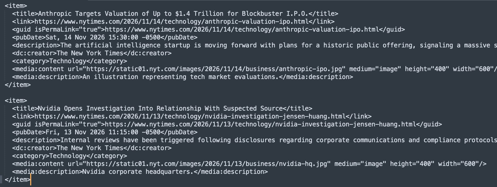
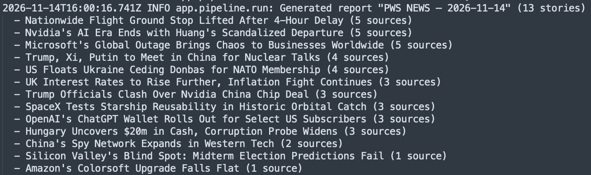
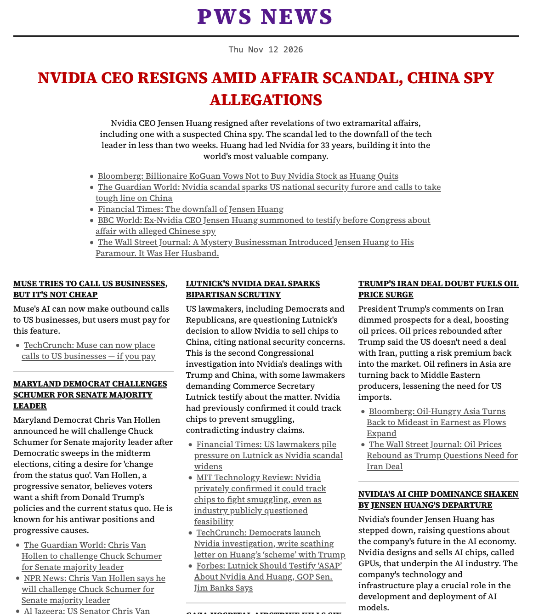
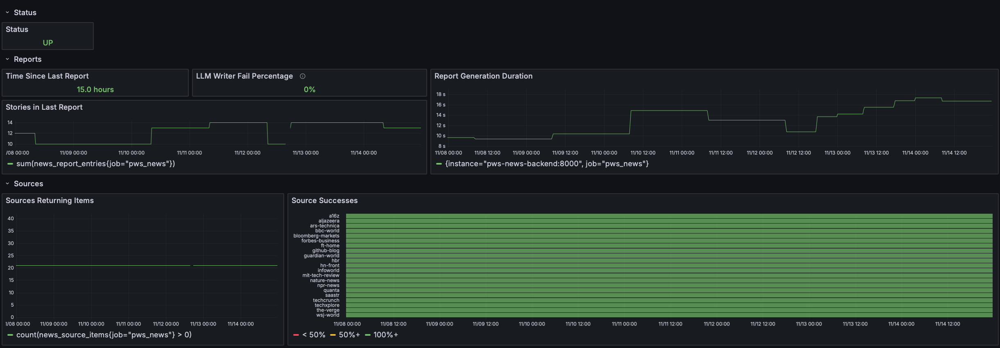

AI claims yet another victim as I replace my folder of news sites with a daily news report generated by local AI running on [PWS](/projects/pws), my homelab. 

## Why??
Over years of maintaining a folder of news publisher links, I found myself limiting my news interactions to a cursory scroll of Hacker News day to day. Moreover, as my interests tend to lie more squarely in the tech world, I tend to not look that deeply into finance or world events on a day-to-day basis. 

I decided to solve this behavioral problem by building a tool that gives me a single jumpoff point for my daily news reading. PWS News is a simple news aggregator that combines headlines from many sources to give an overview of ongoing topics, and provide quick access to dig deeper, if you choose to.

While I've noticed that this sort of productivity tool has become quite trendy lately, in the words of the [Rifleman's Creed](https://www.usmcu.edu/Research/Marine-Corps-History-Division/Frequently-Requested-Topics/Marines-Rifle-Creed/), **"There are many like it, but this one is mine."**

## Local! LLMs! Local! LLMs!
As I'm currently taking a work sabbatical, and paying for my own tokens, it is important that I think about cost operations when starting new projects. I choose to self-host the largest frontier LLMs that work on my hardware, and supply my AI features using these where possible. 

I use [LLaMA.cpp](https://llama-cpp.com) as my inference platform of choice, which currently serves an open-weight *LLaMA 3.1* model, sized for my infrastructure, as well as the fully open-source Nomic embedding model as the AI sources backing this project. 

## How do we Make New News?
First, we look at what data is available. For v1, it was the simplest to look at common news feeds and use this as our data.

You'll notice from this example that we get a few important pieces of information. Rather than sending just links, the RSS feed contains a short description of the article. From a single one of these we can easily get a sense of the direction of the article. Layer a few of these together, and we have a shallow, high-level understanding of the story. 

## Coming up with Stories

As one might quickly realize, it's not uncommon for many of our news sources to report on the same stories.

So how do we take our collection of news article descriptions and link them together? 

The answer for me was to take a page from transformer architecture and use embedding to give us a mathematical approximation of each of our news articles. Unlike transformers we don't have sequences (at the moment, more on this in next steps), so we can avoid using multi-head attention to relate our stories' approximations together. 

Once our news articles have been converted into an array of vectors, we can perform average linkage agglomerative clustering (overview [here](https://en.wikipedia.org/wiki/Hierarchical_clustering)) to yield us a representation of our vectors' relationships to eachother. From there, we can specify a number of clusters (which represent stories in our case) and have effectively sorted our news articles into groupings based on the story that they belong to.

There is one very important reason to design this way, and it is visualized in the following image: 

The fact that we have control over the clustering size allows us to control how different articles have to be to be considered a different story. In this day's news, Nvidia CEO Jensen Huang resigns over his infidelity scandal in one headline story, while the smaller story of Nvidia's AI Chip Dominance being threatened by Huang's departure is a different, yet related topic altogether.

After the clustering, we're able to rely on our LLM to formulate us a headline and description from the RSS feed data. 

## Monitoring
Aside from looking at logs, the application emits some relevant logging to help us figure out what sources respond with data, how long LLM operations take, and what failback path we take in the event of issues with headline generation.

## Next Steps
I implement new features as they come to me, but keep the overall direction of this project intact. 

Some things I'll eventually work on:
- Historical news articles - Storing intermediate article/report data historically (instead of just the archival post as I do now) will let us use historical context when generating a new story. We'll be able to pick up if certain headlines are continuations of previous reporting, refer to past reporting, etc.
