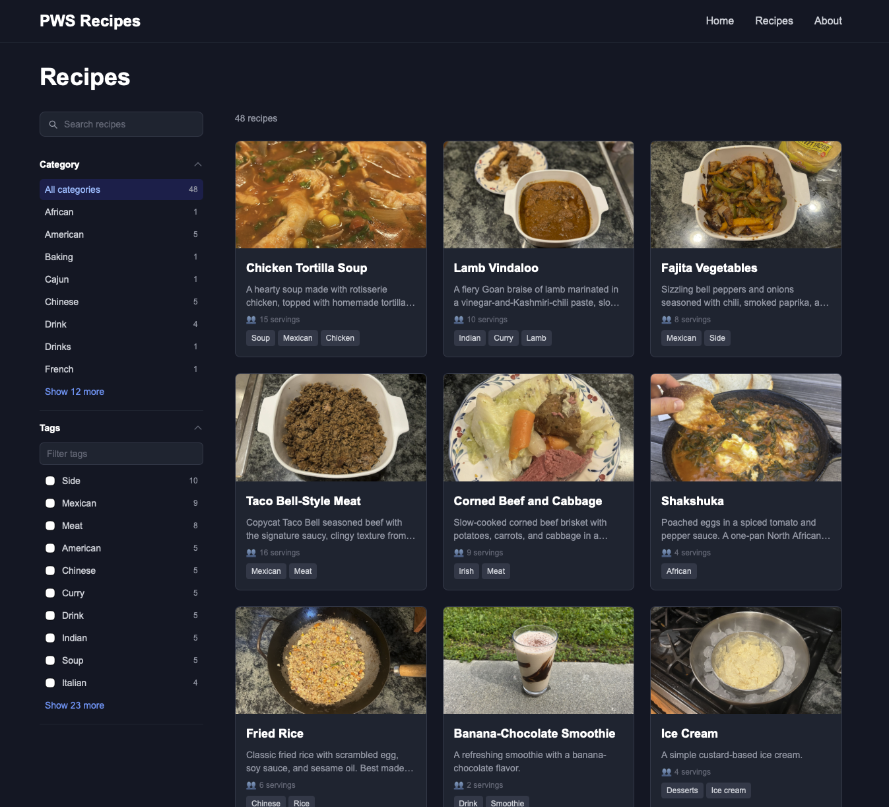

PWS news is my online cookbook, a collection of recipes that I've enjoyed cooking, those that I've come up with myself, and a folder of dishes that I plan to make many more times in the future.

It is designed this as a content-driven web framework, rendering markdown as webpages through a custom rendering engine and caching the result at the edge level for performance. 

## Links
1. [PWS Recipes](https://recipes.whitney.rip)
2. [2026/02/08 Blog Post](/blog/2026.02.08-pws-recipes)
3. [PWS Recipes Github Repository](https://github.com/runyanjake/cooking)

