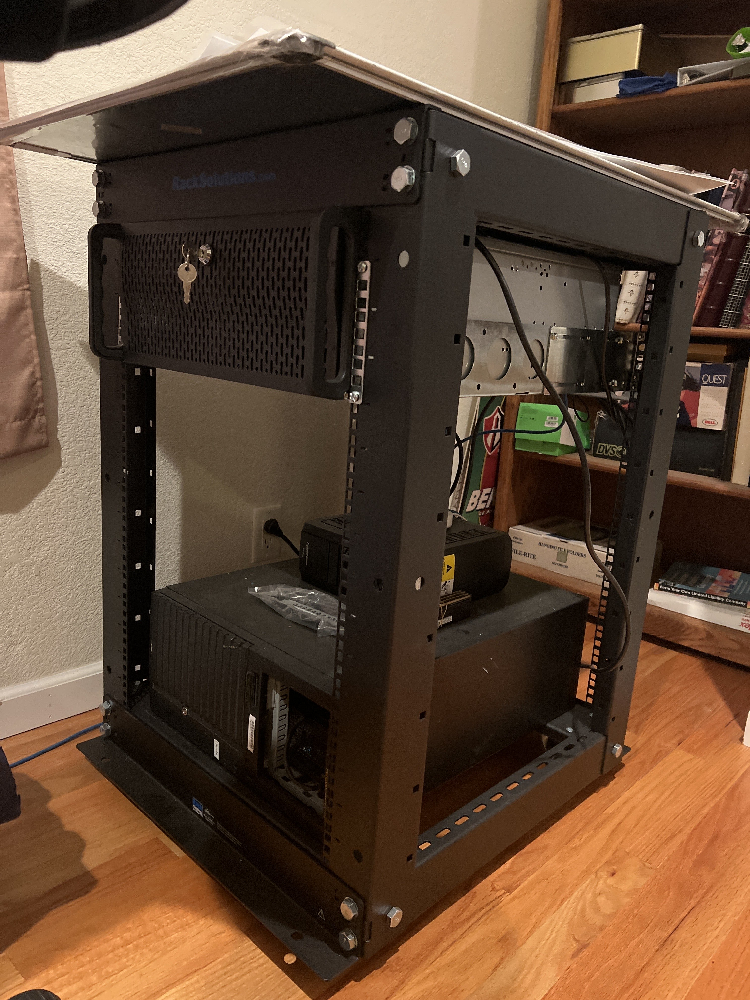

PWS is the codename for my homelabbing project, a pursuit that has taught me much about system maintenance, networking, and security practices. As you might be able to tell, its name is a parody of the much more famous AWS (Amazon Web Services) moniker. I use my home infrastructure to host my side projects, manage IOT devices, and try out the open source software flavor of the week.

## Links
1. [PWS Website](https://whitney.rip)
2. [202/12/07 Blog Post](/blog/2020.12.07-pws)
2. [PWS Services List](https://whitney.rip/services.html)
3. [PWS Infrastructure-as-Code Repo (Github)](https://github.com/runyanjake/olomana)
4. [PWS Infractructure-as-Code Repo Mirror (Gitea)](https://git.whitney.rip/jr/olomana)
