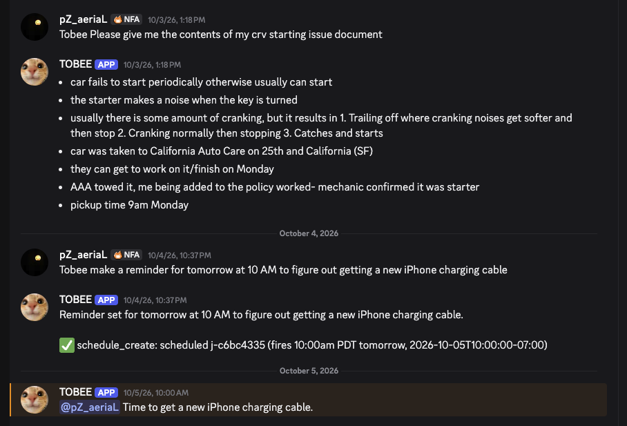

TOBEE is a custom agent harness I wrote to provide personal assistant capabilities on top of fronteir local LLMs, to break dependencies on managed inference, minimize costs, and to explore the practical applications of agent architecture.

It currently features multi-user support through a Discord integration, exposes a number of tools through MCP such as mounted filesystem support, grep-style search, and task scheduling backed by `cron`. 

## Links
1. [2026/09/15 Blog Post](/blog/2026.09.15-tobee-harness)
2. [TOBEE Github Repository](https://github.com/runyanjake/tobee)
